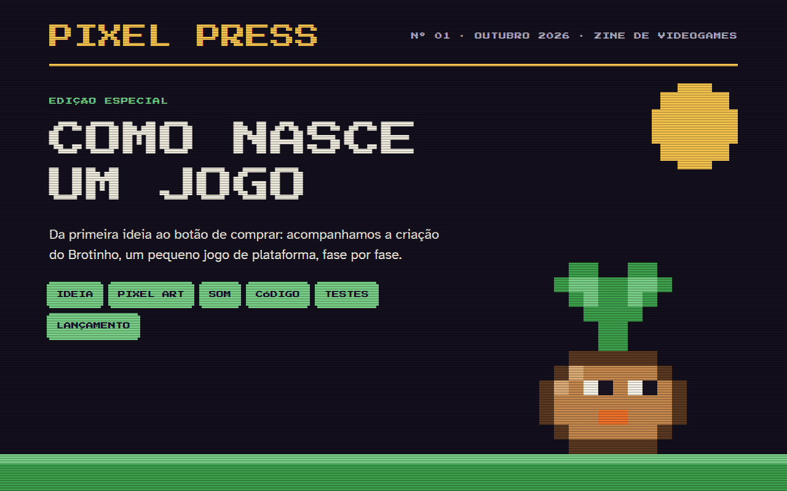

# Pixel Press nº 1 · Como nasce um jogo

Página de estudo da Fase 1 do portfólio (HTML + CSS). É a primeira edição de uma zine de videogames que acompanha a criação de um pequeno jogo, o Brotinho, da ideia ao lançamento. Ela é construída etapa por etapa, um conceito por commit, para ser usada em aula.

## No ar

[pixel-press-renanferreira-dev.vercel.app](https://pixel-press-renanferreira-dev.vercel.app)

## Como abrir

Não precisa instalar nada: abra o arquivo `index.html` no navegador.

Para ver a página como ela estava em uma etapa, use `git log --oneline` e depois `git checkout <hash>`. Para voltar ao fim do projeto, `git checkout main`.

## Etapas

- `00-ponto-de-partida`: esqueleto do documento HTML.
- `01-estrutura-editorial`: todo o conteúdo da revista em HTML semântico, ainda sem CSS.
- `02-tipografia`: `style.css` com as fontes Press Start 2P e Atkinson Hyperlegible, escala de tamanhos, `line-height` e `letter-spacing`.
- `03-paleta-com-variaveis`: cores em variáveis `--color-*`, contraste conferido e fundos alternados noite e papel.
- `04-grid-de-colunas`: grid de 12 colunas em todos os blocos, com `grid-column`, `margin`, `padding` e `border`.
- `05-grid-areas`: mosaico de depoimentos com `grid-template-areas`.
- `06-grid-aninhado`: grids dentro do grid (regras, canais, passos, paleta e glossário) e `flex` nas barras simples.
- `07-position`: sol, lugar do Brotinho e chão da capa com `position: absolute` dentro de `position: relative`.
- `08-box-shadow`: o Brotinho e o sol em pixel art com `box-shadow`, ampliados com `transform: scale`, e as bordas pixeladas.
- `09-gradientes`: scanlines na capa com `repeating-linear-gradient` e a grade de 32 px atrás do sprite com `linear-gradient`.
- `10-hover-e-foco`: `:hover` e `:focus-visible` nos links do sumário e no botão COMPRAR, com contorno de foco bem visível.
- `11-css-nesting`: o `style.css` reescrito com CSS nesting nativo, com o mesmo resultado visual.

## Pontos de atenção

### Onde costuma travar

- `01-estrutura-editorial`: escolher a tag certa. `article` é a matéria que faz sentido sozinha, `aside` é o conteúdo ao lado dela, `ol` é para quando a ordem importa e `ul` para quando não importa.
- `02-tipografia`: a Press Start 2P não tem negrito. Sem `font-weight: 400`, o navegador engrossa as letras à força no `h1` e nos `h3`.
- `03-paleta-com-variaveis`: um `span` vazio não aparece. As amostras da paleta só surgem com `display: block` e `height`.
- `04-grid-de-colunas`: `grid-column: 4 / 9` conta as **linhas** do grid, não as colunas. Ocupa as colunas 4 a 8.
- `04-grid-de-colunas`: com `1fr`, uma palavra comprida alarga a coluna; `minmax(0, 1fr)` mantém as 12 colunas iguais.
- `05-grid-areas`: cada área precisa ser um retângulo. Um formato em L não funciona, e o grid ignora o layout inteiro.
- `06-grid-aninhado`: nem tudo precisa de grid. Uma linha só, sem colunas para alinhar, resolve com `flex`.
- `07-position`: `position: absolute` mede a partir do ancestral com `position: relative` mais próximo. Sem ele na capa, o sol vai parar no canto da página.
- `08-box-shadow`: o elemento não mostra a própria sombra por baixo dele. Por isso o "pixel" fica um pixel para fora e as sombras começam no pixel 1.
- `08-box-shadow`: `transform: scale` aumenta o desenho, mas não o espaço que ele ocupa no layout, e sombra também não ocupa espaço.
- `09-gradientes`: gradiente é imagem, então vai em `background-image`. Em `background-color`, ele é ignorado.
- `09-gradientes`: a camada de scanlines fica por cima de tudo. Sem `pointer-events: none`, ela fica no caminho do mouse: seleção de texto e cliques na capa batem na camada, não no conteúdo.
- `10-hover-e-foco`: o contorno de foco precisa contrastar com o fundo. A cor muda entre o papel e a loja escura.
- `11-css-nesting`: reorganizar o CSS muda a ordem das regras. Com a mesma especificidade, a que vem depois vence, então a página pode mudar sem ninguém ter mexido nos valores.

### O que eu faria diferente

- Dividiria `04-grid-de-colunas` e `08-box-shadow` em etapas menores. As duas juntaram vários conceitos (grid, `box-sizing`, `:last-child`, `align-self` e `columns` na primeira; pixel art, `scale`, bordas pixeladas e margem negativa na segunda).
- Faria o deploy na Vercel na primeira versão que abre no navegador, não no fim. Essa virou regra dos próximos projetos.
- A página foi pensada para telas de 1280 px. Uma versão para celular seria o próximo passo.

## Navegadores

A página foi feita para telas de computador, a partir de 1280 px de largura. A versão para celular fica para depois.

A partir da etapa `11-css-nesting`, o `style.css` usa CSS nesting nativo, suportado no Chrome 120+, Firefox 117+ e Safari 17.2+. Em navegadores mais antigos, as regras aninhadas são ignoradas e a página perde parte do estilo.

## Créditos

Projeto educacional de Renan Ferreira. O Brotinho, sua equipe e seus testadores são fictícios. Não há imagens externas: toda a arte, incluindo o Brotinho e o sol, foi feita com CSS.

Fontes [Press Start 2P](https://fonts.google.com/specimen/Press+Start+2P) e [Atkinson Hyperlegible](https://fonts.google.com/specimen/Atkinson+Hyperlegible), do Google Fonts, sob a licença SIL Open Font License.

## Licença

Código sob a licença MIT. Veja o arquivo [LICENSE](LICENSE).
